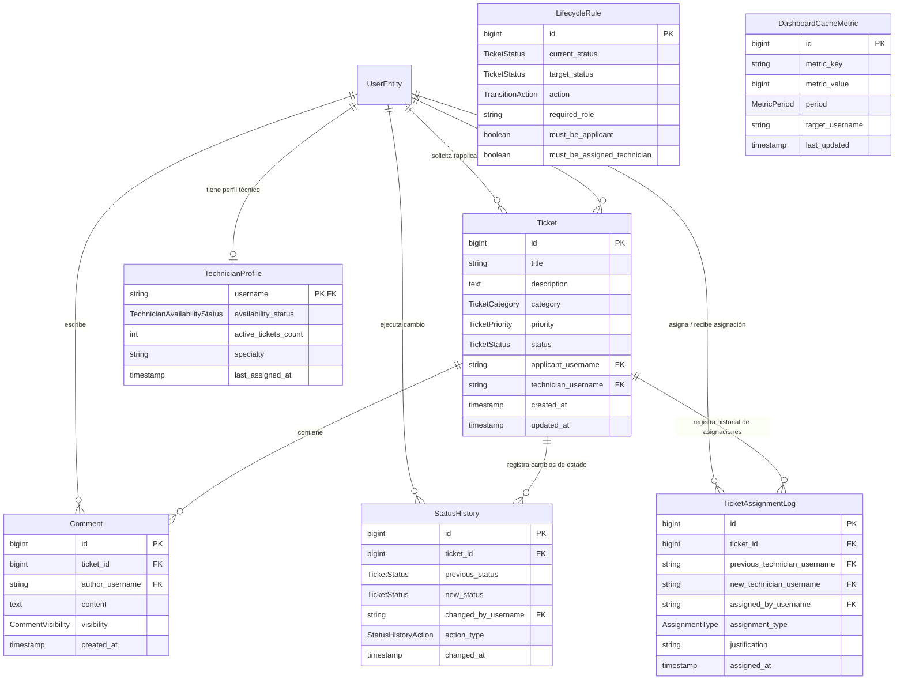

# Código JPA: Entidades y Enums - CAMPUSDESK

Este documento contiene la implementación propuesta en código Java (JPA / Hibernate / Lombok) para todas las **Entidades** y **Enums** del proyecto **CAMPUSDESK**, organizadas según la arquitectura modular desacoplada.

> **Nota:** Este documento es exclusivamente para análisis y diseño de la base de datos y modelo de dominio. No ha sido aplicado a los archivos `.java` del código fuente.

---

## Índice de Contenidos

1. [Módulo `ticket`](#1-módulo-ticket)
   - [Enums: `TicketCategory`, `TicketPriority`](#11-enums)
   - [Entidad: `Ticket`](#12-entidad-ticket)
2. [Módulo `lifecycle`](#2-módulo-lifecycle)
   - [Enums: `TicketStatus`, `TransitionAction`](#21-enums)
   - [Matriz de Ciclo de Vida y Transiciones (`TicketStatus`)](#matriz-de-ciclo-de-vida-y-transiciones-de-estado-rf-04--rt-02)
   - [Entidad: `LifecycleRule`](#22-entidad-lifecyclerule)
3. [Módulo `assignment`](#3-módulo-assignment)
   - [Enum: `AssignmentType`](#31-enum)
   - [Entidad: `TicketAssignmentLog`](#32-entidad-ticketassignmentlog)
4. [Módulo `comment`](#4-módulo-comment)
   - [Enum: `CommentVisibility`](#41-enum)
   - [Entidad: `Comment`](#42-entidad-comment)
5. [Módulo `statushistory`](#5-módulo-statushistory)
   - [Enum: `StatusHistoryAction`](#51-enum)
   - [Entidad: `StatusHistory`](#52-entidad-statushistory)
6. [Módulo `dashboard`](#6-módulo-dashboard)
   - [Enum: `MetricPeriod`](#61-enum)
   - [Entidad: `DashboardCacheMetric`](#62-entidad-dashboardcachemetric)
7. [Módulo `technician`](#7-módulo-technician)
   - [Enum: `TechnicianAvailabilityStatus`](#71-enum)
   - [Entidad: `TechnicianProfile`](#72-entidad-technicianprofile)
8. [Relación entre Entidades (Diagrama ER Conceptual)](#8-relación-entre-entidades-diagrama-er-conceptual)
9. [Matriz de Completitud Técnica: Entidades y Enums](#9-matriz-de-completitud-técnica-entidades-y-enums)

---

## 1. Módulo `ticket`

### 1.1. Enums

#### `TicketCategory.java`
**Ubicación:** `com.roles.usermanagement.modules.ticket.enums.TicketCategory`
```java
package com.roles.usermanagement.modules.ticket.enums;

/**
 * Categorías permitidas según el requerimiento RF-03.
 */
public enum TicketCategory {
    HARDWARE,
    SOFTWARE,
    REDES,
    ACCESOS,
    OTROS
}
```

#### `TicketPriority.java`
**Ubicación:** `com.roles.usermanagement.modules.ticket.enums.TicketPriority`
```java
package com.roles.usermanagement.modules.ticket.enums;

/**
 * Niveles de urgencia permitidos según el requerimiento RF-03.
 */
public enum TicketPriority {
    BAJA,
    MEDIA,
    ALTA,
    CRITICA
}
```

---

### 1.2. Entidad `Ticket`

#### `Ticket.java`
**Ubicación:** `com.roles.usermanagement.modules.ticket.entity.Ticket`
```java
package com.roles.usermanagement.modules.ticket.entity;

import com.roles.usermanagement.modules.lifecycle.enums.TicketStatus;
import com.roles.usermanagement.modules.ticket.enums.TicketCategory;
import com.roles.usermanagement.modules.ticket.enums.TicketPriority;
import com.roles.usermanagement.persistance.entity.UserEntity;
import jakarta.persistence.*;
import lombok.*;

import java.time.LocalDateTime;

/**
 * Entidad principal que representa una incidencia tecnológica en PostgreSQL (RF-03, RT-02).
 */
@Getter
@Setter
@NoArgsConstructor
@AllArgsConstructor
@Builder
@Entity
@Table(name = "tickets", indexes = {
    @Index(name = "idx_ticket_status", columnList = "status"),
    @Index(name = "idx_ticket_applicant", columnList = "applicant_username"),
    @Index(name = "idx_ticket_technician", columnList = "technician_username")
})
public class Ticket {

    @Id
    @GeneratedValue(strategy = GenerationType.IDENTITY)
    private Long id;

    @Column(nullable = false, length = 150)
    private String title;

    @Column(nullable = false, columnDefinition = "TEXT")
    private String description;

    @Enumerated(EnumType.STRING)
    @Column(nullable = false, length = 30)
    private TicketCategory category;

    @Enumerated(EnumType.STRING)
    @Column(nullable = false, length = 20)
    private TicketPriority priority;

    @Enumerated(EnumType.STRING)
    @Column(nullable = false, length = 30)
    private TicketStatus status;

    /**
     * Usuario que creó la incidencia (Solicitante).
     */
    @ManyToOne(fetch = FetchType.LAZY, optional = false)
    @JoinColumn(name = "applicant_username", referencedColumnName = "username", nullable = false)
    private UserEntity applicant;

    /**
     * Técnico asignado para atender la incidencia.
     * Puede ser nulo mientras el ticket permanezca en estado ABIERTA.
     */
    @ManyToOne(fetch = FetchType.LAZY)
    @JoinColumn(name = "technician_username", referencedColumnName = "username")
    private UserEntity technician;

    @Column(name = "created_at", nullable = false, updatable = false)
    private LocalDateTime createdAt;

    @Column(name = "updated_at")
    private LocalDateTime updatedAt;

    @PrePersist
    protected void onCreate() {
        this.createdAt = LocalDateTime.now();
        this.updatedAt = LocalDateTime.now();
        if (this.status == null) {
            this.status = TicketStatus.ABIERTA;
        }
    }

    @PreUpdate
    protected void onUpdate() {
        this.updatedAt = LocalDateTime.now();
    }
}
```

---

## 2. Módulo `lifecycle`

### 2.1. Enums

#### `TicketStatus.java`
**Ubicación:** `com.roles.usermanagement.modules.lifecycle.enums.TicketStatus`
```java
package com.roles.usermanagement.modules.lifecycle.enums;

/**
 * Flujo de atención controlado según el requerimiento RF-04:
 * ABIERTA -> ASIGNADA -> EN_PROCESO -> RESUELTA -> CERRADA
 */
public enum TicketStatus {
    ABIERTA,
    ASIGNADA,
    EN_PROCESO,
    RESUELTA,
    CERRADA
}
```

##### Matriz de Ciclo de Vida y Transiciones de Estado (RF-04 / RT-02)

| Estado Origen (`TicketStatus`) | Acción (`TransitionAction`) | Estado Destino (`TicketStatus`) | Rol Autorizado | Regla de Negocio / Restricción |
| :--- | :--- | :--- | :--- | :--- |
| `ABIERTA` | `ASSIGN` | `ASIGNADA` | `ROLE_ADMIN` | Asigna técnico. El técnico debe estar en `TechnicianAvailabilityStatus.AVAILABLE`. |
| `ASIGNADA` | `REASSIGN` | `ASIGNADA` | `ROLE_ADMIN` | Permite transferir a otro técnico disponible; requiere justificación en `TicketAssignmentLog`. |
| `ASIGNADA` | `START_PROGRESS` | `EN_PROCESO` | `ROLE_TECHNICIAN` | Solo el técnico asignado (`mustBeAssignedTechnician = true`) puede iniciar. |
| `EN_PROCESO` | `RESOLVE` | `RESUELTA` | `ROLE_TECHNICIAN` | Solo el técnico asignado puede marcar como resuelta al finalizar el trabajo. |
| `RESUELTA` | `CONFIRM_CLOSE` | `CERRADA` | `ROLE_USER` / `ROLE_ADMIN` | El usuario solicitante confirma conformidad o el admin cierra administrativamente. Estado final inmutable. |

#### `TransitionAction.java`
**Ubicación:** `com.roles.usermanagement.modules.lifecycle.enums.TransitionAction`
```java
package com.roles.usermanagement.modules.lifecycle.enums;

/**
 * Acciones semánticas que disparan cambios de estado en el ciclo de vida.
 */
public enum TransitionAction {
    ASSIGN,          // ABIERTA -> ASIGNADA (ADMIN)
    REASSIGN,        // ASIGNADA -> ASIGNADA (ADMIN)
    START_PROGRESS,  // ASIGNADA -> EN_PROCESO (TECHNICIAN)
    RESOLVE,         // EN_PROCESO -> RESUELTA (TECHNICIAN)
    CONFIRM_CLOSE    // RESUELTA -> CERRADA (USER solicitante)
}
```

---

### 2.2. Entidad `LifecycleRule`

#### `LifecycleRule.java`
**Ubicación:** `com.roles.usermanagement.modules.lifecycle.entity.LifecycleRule`
```java
package com.roles.usermanagement.modules.lifecycle.entity;

import com.roles.usermanagement.modules.lifecycle.enums.TicketStatus;
import com.roles.usermanagement.modules.lifecycle.enums.TransitionAction;
import jakarta.persistence.*;
import lombok.*;

/**
 * Representa las transiciones permitidas por la máquina de estados y las reglas del backend (RF-04).
 */
@Getter
@Setter
@NoArgsConstructor
@AllArgsConstructor
@Builder
@Entity
@Table(name = "ticket_lifecycle_rules", uniqueConstraints = {
    @UniqueConstraint(name = "uk_lifecycle_transition", columnNames = {"current_status", "target_status", "action"})
})
public class LifecycleRule {

    @Id
    @GeneratedValue(strategy = GenerationType.IDENTITY)
    private Long id;

    @Enumerated(EnumType.STRING)
    @Column(name = "current_status", nullable = false, length = 30)
    private TicketStatus currentStatus;

    @Enumerated(EnumType.STRING)
    @Column(name = "target_status", nullable = false, length = 30)
    private TicketStatus targetStatus;

    @Enumerated(EnumType.STRING)
    @Column(nullable = false, length = 30)
    private TransitionAction action;

    @Column(name = "required_role", nullable = false, length = 50)
    private String requiredRole; // e.g. "ROLE_ADMIN", "ROLE_TECHNICIAN", "ROLE_USER"

    @Column(name = "must_be_applicant", nullable = false)
    private boolean mustBeApplicant = false;

    @Column(name = "must_be_assigned_technician", nullable = false)
    private boolean mustBeAssignedTechnician = false;
}
```

---

## 3. Módulo `assignment`

### 3.1. Enum

#### `AssignmentType.java`
**Ubicación:** `com.roles.usermanagement.modules.assignment.enums.AssignmentType`
```java
package com.roles.usermanagement.modules.assignment.enums;

/**
 * Distingue la primera asignación de una reasignación administrativa posterior (RF-04 regla 9).
 */
public enum AssignmentType {
    INITIAL,
    REASSIGNMENT
}
```

---

### 3.2. Entidad `TicketAssignmentLog`

#### `TicketAssignmentLog.java`
**Ubicación:** `com.roles.usermanagement.modules.assignment.entity.TicketAssignmentLog`
```java
package com.roles.usermanagement.modules.assignment.entity;

import com.roles.usermanagement.modules.assignment.enums.AssignmentType;
import com.roles.usermanagement.modules.ticket.entity.Ticket;
import com.roles.usermanagement.persistance.entity.UserEntity;
import jakarta.persistence.*;
import lombok.*;

import java.time.LocalDateTime;

/**
 * Registro de auditoría específico de asignación y reasignación de personal técnico (Reto 3 — Auditoría).
 */
@Getter
@Setter
@NoArgsConstructor
@AllArgsConstructor
@Builder
@Entity
@Table(name = "ticket_assignment_logs")
public class TicketAssignmentLog {

    @Id
    @GeneratedValue(strategy = GenerationType.IDENTITY)
    private Long id;

    @ManyToOne(fetch = FetchType.LAZY, optional = false)
    @JoinColumn(name = "ticket_id", nullable = false)
    private Ticket ticket;

    @ManyToOne(fetch = FetchType.LAZY)
    @JoinColumn(name = "previous_technician_username", referencedColumnName = "username")
    private UserEntity previousTechnician;

    @ManyToOne(fetch = FetchType.LAZY, optional = false)
    @JoinColumn(name = "new_technician_username", referencedColumnName = "username", nullable = false)
    private UserEntity newTechnician;

    @ManyToOne(fetch = FetchType.LAZY, optional = false)
    @JoinColumn(name = "assigned_by_username", referencedColumnName = "username", nullable = false)
    private UserEntity assignedBy;

    @Enumerated(EnumType.STRING)
    @Column(name = "assignment_type", nullable = false, length = 20)
    private AssignmentType assignmentType;

    @Column(name = "justification", length = 300)
    private String justification;

    @Column(name = "assigned_at", nullable = false, updatable = false)
    private LocalDateTime assignedAt;

    @PrePersist
    protected void onCreate() {
        this.assignedAt = LocalDateTime.now();
    }
}
```

---

## 4. Módulo `comment`

### 4.1. Enum

#### `CommentVisibility.java`
**Ubicación:** `com.roles.usermanagement.modules.comment.enums.CommentVisibility`
```java
package com.roles.usermanagement.modules.comment.enums;

/**
 * Ámbito de visibilidad del comentario (público para todos o nota interna para técnicos/admin).
 */
public enum CommentVisibility {
    PUBLIC,
    INTERNAL
}
```

---

### 4.2. Entidad `Comment`

#### `Comment.java`
**Ubicación:** `com.roles.usermanagement.modules.comment.entity.Comment`
```java
package com.roles.usermanagement.modules.comment.entity;

import com.roles.usermanagement.modules.comment.enums.CommentVisibility;
import com.roles.usermanagement.modules.ticket.entity.Ticket;
import com.roles.usermanagement.persistance.entity.UserEntity;
import jakarta.persistence.*;
import lombok.*;

import java.time.LocalDateTime;

/**
 * Entidad que registra los comentarios y bitácora de atención de cada incidencia (RF-05, RT-02).
 */
@Getter
@Setter
@NoArgsConstructor
@AllArgsConstructor
@Builder
@Entity
@Table(name = "ticket_comments", indexes = {
    @Index(name = "idx_comment_ticket_created", columnList = "ticket_id, created_at")
})
public class Comment {

    @Id
    @GeneratedValue(strategy = GenerationType.IDENTITY)
    private Long id;

    @Column(nullable = false, columnDefinition = "TEXT")
    private String content;

    /**
     * Usuario autor del comentario.
     */
    @ManyToOne(fetch = FetchType.LAZY, optional = false)
    @JoinColumn(name = "author_username", referencedColumnName = "username", nullable = false)
    private UserEntity author;

    /**
     * Incidencia a la que pertenece el comentario.
     */
    @ManyToOne(fetch = FetchType.LAZY, optional = false)
    @JoinColumn(name = "ticket_id", nullable = false)
    private Ticket ticket;

    @Enumerated(EnumType.STRING)
    @Column(nullable = false, length = 20)
    private CommentVisibility visibility;

    @Column(name = "created_at", nullable = false, updatable = false)
    private LocalDateTime createdAt;

    @PrePersist
    protected void onCreate() {
        this.createdAt = LocalDateTime.now();
        if (this.visibility == null) {
            this.visibility = CommentVisibility.PUBLIC;
        }
    }
}
```

---

## 5. Módulo `statushistory`

### 5.1. Enum

#### `StatusHistoryAction.java`
**Ubicación:** `com.roles.usermanagement.modules.statushistory.enums.StatusHistoryAction`
```java
package com.roles.usermanagement.modules.statushistory.enums;

/**
 * Tipo de acción que motivó la entrada en el historial de estados (RF-06).
 */
public enum StatusHistoryAction {
    CREATION,
    ASSIGNMENT,
    STATUS_TRANSITION,
    CLOSURE
}
```

---

### 5.2. Entidad `StatusHistory`

#### `StatusHistory.java`
**Ubicación:** `com.roles.usermanagement.modules.statushistory.entity.StatusHistory`
```java
package com.roles.usermanagement.modules.statushistory.entity;

import com.roles.usermanagement.modules.lifecycle.enums.TicketStatus;
import com.roles.usermanagement.modules.statushistory.enums.StatusHistoryAction;
import com.roles.usermanagement.modules.ticket.entity.Ticket;
import com.roles.usermanagement.persistance.entity.UserEntity;
import jakarta.persistence.*;
import lombok.*;

import java.time.LocalDateTime;

/**
 * Entidad inmutable de auditoría para trazabilidad de cambios de estado (RF-06, RT-02).
 */
@Getter
@Setter
@NoArgsConstructor
@AllArgsConstructor
@Builder
@Entity
@Table(name = "ticket_status_history", indexes = {
    @Index(name = "idx_history_ticket_changed", columnList = "ticket_id, changed_at")
})
public class StatusHistory {

    @Id
    @GeneratedValue(strategy = GenerationType.IDENTITY)
    private Long id;

    @ManyToOne(fetch = FetchType.LAZY, optional = false)
    @JoinColumn(name = "ticket_id", nullable = false)
    private Ticket ticket;

    @Enumerated(EnumType.STRING)
    @Column(name = "previous_status", length = 30)
    private TicketStatus previousStatus; // Nulo al momento de la creación inicial

    @Enumerated(EnumType.STRING)
    @Column(name = "new_status", nullable = false, length = 30)
    private TicketStatus newStatus;

    @ManyToOne(fetch = FetchType.LAZY, optional = false)
    @JoinColumn(name = "changed_by_username", referencedColumnName = "username", nullable = false)
    private UserEntity changedBy;

    @Enumerated(EnumType.STRING)
    @Column(name = "action_type", length = 30)
    private StatusHistoryAction action;

    @Column(name = "changed_at", nullable = false, updatable = false)
    private LocalDateTime changedAt;

    @PrePersist
    protected void onCreate() {
        this.changedAt = LocalDateTime.now();
    }
}
```

---

## 6. Módulo `dashboard`

### 6.1. Enum

#### `MetricPeriod.java`
**Ubicación:** `com.roles.usermanagement.modules.dashboard.enums.MetricPeriod`
```java
package com.roles.usermanagement.modules.dashboard.enums;

/**
 * Período de agregación para consultas y reportes de indicadores (RF-07).
 */
public enum MetricPeriod {
    TODAY,
    THIS_WEEK,
    THIS_MONTH,
    ALL_TIME
}
```

---

### 6.2. Entidad `DashboardCacheMetric`

#### `DashboardCacheMetric.java`
**Ubicación:** `com.roles.usermanagement.modules.dashboard.entity.DashboardCacheMetric`
```java
package com.roles.usermanagement.modules.dashboard.entity;

import com.roles.usermanagement.modules.dashboard.enums.MetricPeriod;
import jakarta.persistence.*;
import lombok.*;

import java.time.LocalDateTime;

/**
 * Almacena métricas precalculadas o de soporte para reportes y panel de indicadores (RF-07).
 */
@Getter
@Setter
@NoArgsConstructor
@AllArgsConstructor
@Builder
@Entity
@Table(name = "dashboard_metrics_cache", uniqueConstraints = {
    @UniqueConstraint(name = "uk_metric_scope", columnNames = {"metric_key", "period", "target_username"})
})
public class DashboardCacheMetric {

    @Id
    @GeneratedValue(strategy = GenerationType.IDENTITY)
    private Long id;

    @Column(name = "metric_key", nullable = false, length = 60)
    private String metricKey; // e.g. "TOTAL_TICKETS", "OPEN_TICKETS", "RESOLVED_TICKETS"

    @Column(name = "metric_value", nullable = false)
    private Long metricValue;

    @Enumerated(EnumType.STRING)
    @Column(nullable = false, length = 20)
    private MetricPeriod period;

    @Column(name = "target_username", length = 50)
    private String targetUsername; // Nulo para indicadores globales de ADMIN

    @Column(name = "last_updated", nullable = false)
    private LocalDateTime lastUpdated;

    @PrePersist
    @PreUpdate
    protected void onPersist() {
        this.lastUpdated = LocalDateTime.now();
    }
}
```

---

## 7. Módulo `technician`

### 7.1. Enum

#### `TechnicianAvailabilityStatus.java`
**Ubicación:** `com.roles.usermanagement.modules.technician.enums.TechnicianAvailabilityStatus`
```java
package com.roles.usermanagement.modules.technician.enums;

/**
 * Estatus de disponibilidad operativa del técnico para la asignación de incidencias.
 */
public enum TechnicianAvailabilityStatus {
    AVAILABLE,
    BUSY,
    ON_LEAVE,
    OFFLINE
}
```

---

### 7.2. Entidad `TechnicianProfile`

#### `TechnicianProfile.java`
**Ubicación:** `com.roles.usermanagement.modules.technician.entity.TechnicianProfile`
```java
package com.roles.usermanagement.modules.technician.entity;

import com.roles.usermanagement.modules.technician.enums.TechnicianAvailabilityStatus;
import com.roles.usermanagement.persistance.entity.UserEntity;
import jakarta.persistence.*;
import lombok.*;

import java.time.LocalDateTime;

/**
 * Extensión del perfil de usuario técnico para balanceo de carga y consulta de disponibilidad (RF-01, RT-03).
 */
@Getter
@Setter
@NoArgsConstructor
@AllArgsConstructor
@Builder
@Entity
@Table(name = "technician_profiles")
public class TechnicianProfile {

    /**
     * Clave foránea compartida 1:1 con la clave primaria de UserEntity ("username").
     */
    @Id
    @Column(name = "username", length = 50)
    private String username;

    @OneToOne(fetch = FetchType.LAZY, optional = false)
    @MapsId
    @JoinColumn(name = "username", referencedColumnName = "username")
    private UserEntity user;

    @Enumerated(EnumType.STRING)
    @Column(name = "availability_status", nullable = false, length = 25)
    private TechnicianAvailabilityStatus availabilityStatus;

    @Column(name = "active_tickets_count", nullable = false)
    private Integer activeTicketsCount = 0;

    @Column(name = "specialty", length = 100)
    private String specialty; // e.g. "REDES", "HARDWARE", "SISTEMAS"

    @Column(name = "last_assigned_at")
    private LocalDateTime lastAssignedAt;

    @PrePersist
    protected void onCreate() {
        if (this.availabilityStatus == null) {
            this.availabilityStatus = TechnicianAvailabilityStatus.AVAILABLE;
        }
        if (this.activeTicketsCount == null) {
            this.activeTicketsCount = 0;
        }
    }
}
```

---

## 8. Relación entre Entidades (Diagrama ER Conceptual)



---

## 9. Matriz de Completitud Técnica: Entidades y Enums

A continuación se resume el catálogo definitivo de componentes de dominio y persistencia para CAMPUSDESK:

| Tipo | Componente | Paquete Java | Tabla / Mapeo en BD | Descripción y Relaciones |
| :--- | :--- | :--- | :--- | :--- |
| **Enum** | `TicketCategory` | `...modules.ticket.enums` | `@Column(length = 30)` | Categorías de servicio (`HARDWARE`, `SOFTWARE`, `REDES`, `ACCESOS`, `OTROS`). |
| **Enum** | `TicketPriority` | `...modules.ticket.enums` | `@Column(length = 20)` | Urgencia operativa (`BAJA`, `MEDIA`, `ALTA`, `CRITICA`). |
| **Enum** | `TicketStatus` | `...modules.lifecycle.enums` | `@Column(length = 30)` | Ciclo de vida controlado (`ABIERTA`, `ASIGNADA`, `EN_PROCESO`, `RESUELTA`, `CERRADA`). |
| **Enum** | `TransitionAction` | `...modules.lifecycle.enums` | `@Column(length = 30)` | Acciones semánticas (`ASSIGN`, `REASSIGN`, `START_PROGRESS`, `RESOLVE`, `CONFIRM_CLOSE`). |
| **Enum** | `AssignmentType` | `...modules.assignment.enums` | `@Column(length = 20)` | Naturaleza de la asignación (`INITIAL`, `REASSIGNMENT`). |
| **Enum** | `CommentVisibility` | `...modules.comment.enums` | `@Column(length = 20)` | Nivel de acceso al comentario (`PUBLIC`, `INTERNAL`). |
| **Enum** | `StatusHistoryAction` | `...modules.statushistory.enums` | `@Column(length = 30)` | Evento de auditoría (`CREATION`, `ASSIGNMENT`, `STATUS_TRANSITION`, `CLOSURE`). |
| **Enum** | `MetricPeriod` | `...modules.dashboard.enums` | `@Column(length = 20)` | Ventana temporal de agregación (`TODAY`, `THIS_WEEK`, `THIS_MONTH`, `ALL_TIME`). |
| **Enum** | `TechnicianAvailabilityStatus` | `...modules.technician.enums` | `@Column(length = 25)` | Disponibilidad del técnico (`AVAILABLE`, `BUSY`, `ON_LEAVE`, `OFFLINE`). |
| **Entidad** | `Ticket` | `...modules.ticket.entity` | `tickets` | Incidencia central. Foreign keys a `UserEntity` (`applicant`, `technician`). |
| **Entidad** | `LifecycleRule` | `...modules.lifecycle.entity` | `ticket_lifecycle_rules` | Reglas de transición de estados por rol y propiedad del ticket. |
| **Entidad** | `TicketAssignmentLog` | `...modules.assignment.entity` | `ticket_assignment_logs` | Histórico de asignaciones. FK a `Ticket` y a `UserEntity` (anterior, nuevo, asignador). |
| **Entidad** | `Comment` | `...modules.comment.entity` | `ticket_comments` | Hilo de comunicación y bitácora. FK a `Ticket` y a `UserEntity` (autor). |
| **Entidad** | `StatusHistory` | `...modules.statushistory.entity` | `ticket_status_history` | Auditoría inmutable de transiciones de estado. FK a `Ticket` y `UserEntity`. |
| **Entidad** | `DashboardCacheMetric` | `...modules.dashboard.entity` | `dashboard_metrics_cache` | Caché de indicadores numéricos por período y usuario/global. |
| **Entidad** | `TechnicianProfile` | `...modules.technician.entity` | `technician_profiles` | Perfil técnico extendido con relación 1:1 (`@MapsId`) con `UserEntity`. |
